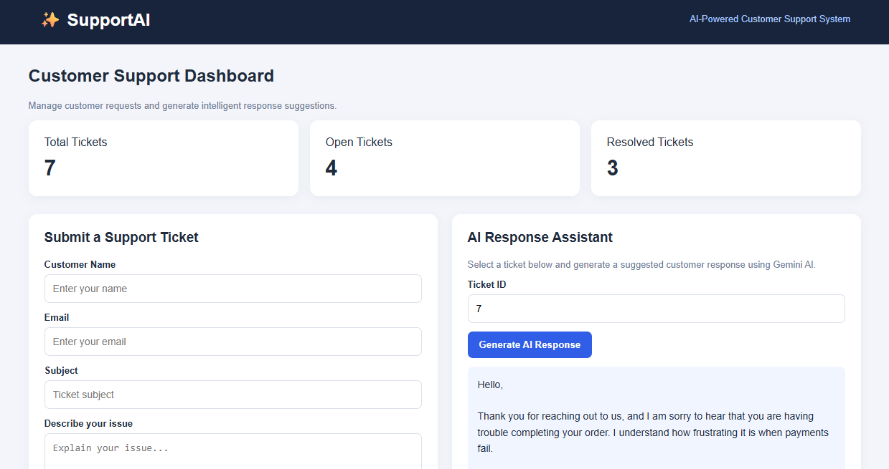
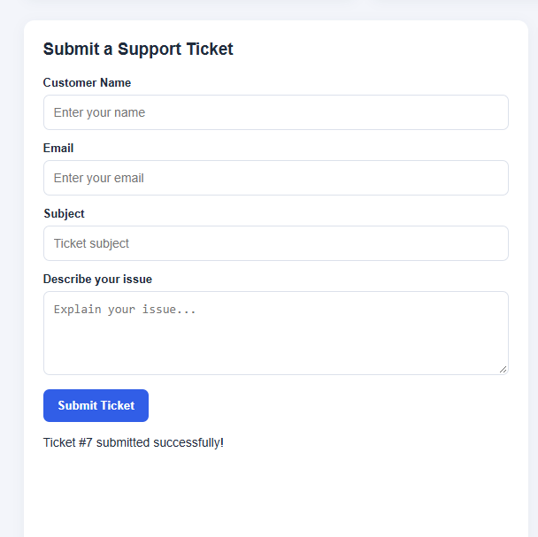
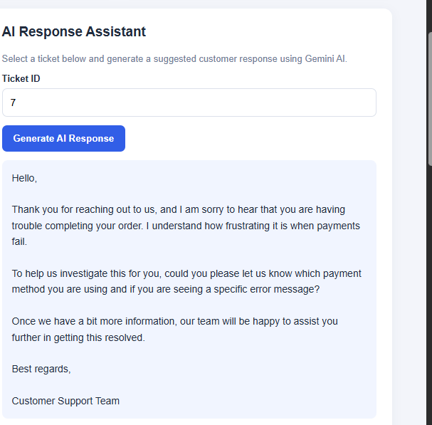
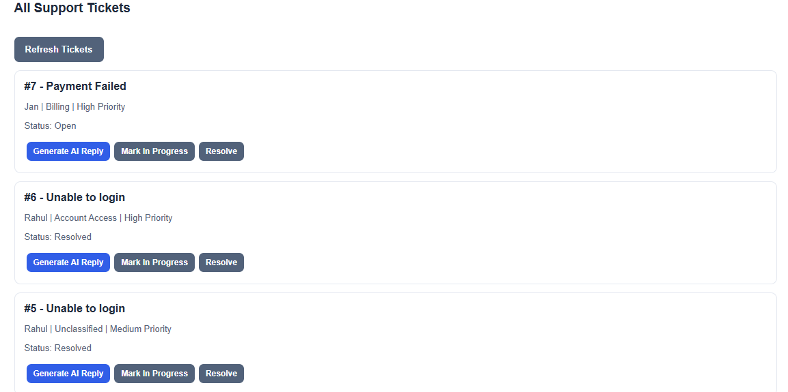

# ✨ SupportAI – AI-Powered Customer Support System

An AI-powered customer support and ticket management application built using Python, FastAPI, SQLite, and Google Gemini AI.

SupportAI helps support teams manage customer requests, classify tickets, identify priority levels, and generate professional AI-assisted responses.

## 🚀 Features

- Customer support ticket submission
- Automatic ticket category classification
- Ticket priority detection
- AI-generated customer response suggestions using Google Gemini
- Dashboard displaying total, open, and resolved tickets
- Ticket status management
- SQLite database integration
- REST API with interactive Swagger documentation

## 🛠️ Tech Stack

- Python
- FastAPI
- SQLite
- Google Gemini AI
- HTML
- CSS
- JavaScript
- Git and GitHub

## 📸 Application Screenshots

### Customer Support Dashboard



### Ticket Submission



### AI Response Assistant



### Support Ticket Management



## 📂 Project Structure

```text
AI-Customer-Support-System/
├── assets/
│   └── screenshots/
├── frontend/
│   └── index.html
├── ai_service.py
├── database.py
├── main.py
├── requirements.txt
├── .gitignore
└── README.md
```

## ⚙️ Installation and Setup

### 1. Clone the repository

```bash
git clone https://github.com/Mabjanshaik17/AI-Customer-Support-System.git
cd AI-Customer-Support-System
```

### 2. Create a virtual environment

```bash
python -m venv .venv
```

### 3. Activate the environment

Windows PowerShell:

```powershell
.venv\Scripts\activate
```

### 4. Install dependencies

```bash
pip install -r requirements.txt
```

### 5. Configure Gemini API

Create a `.env` file in the project root:

```env
GEMINI_API_KEY=your_gemini_api_key
```

Keep your API key private. Never upload `.env` to GitHub.

### 6. Start the backend

```bash
uvicorn main:app --reload
```

Backend URL: http://127.0.0.1:8000

API documentation: http://127.0.0.1:8000/docs

### 7. Start the frontend

Open another terminal:

```bash
cd frontend
python -m http.server 5500
```

Open http://localhost:5500 in your browser.

Keep both servers running.

## 🔗 API Endpoints

| Method | Endpoint | Description |
|---|---|---|
| GET | `/` | Root endpoint |
| GET | `/health` | Health check |
| POST | `/tickets` | Create ticket |
| GET | `/tickets` | Retrieve tickets |
| GET | `/tickets/{ticket_id}` | Retrieve specific ticket |
| PATCH | `/tickets/{ticket_id}/status` | Update ticket status |
| POST | `/tickets/{ticket_id}/suggested-response` | Generate AI response |

## 🤖 How It Works

1. Customer submits a support ticket.
2. Backend analyzes the subject and description.
3. Ticket category and priority are assigned using classification rules.
4. Ticket information is stored in SQLite.
5. Google Gemini AI generates a suggested customer response when requested.
6. Support teams can review responses and update ticket statuses.

AI-generated responses should be reviewed before being sent to customers.

## 🎯 Project Objective

To demonstrate practical applications of Generative AI, backend development, database integration, REST APIs, and frontend development in a customer support environment.

## 👩‍💻 Developer

**Shaik Mahaboob Jan**

B.Tech – Electronics and Communication Engineering | 2026 Graduate

GitHub: https://github.com/Mabjanshaik17

---

Built as an independent project to explore AI-powered software development.
